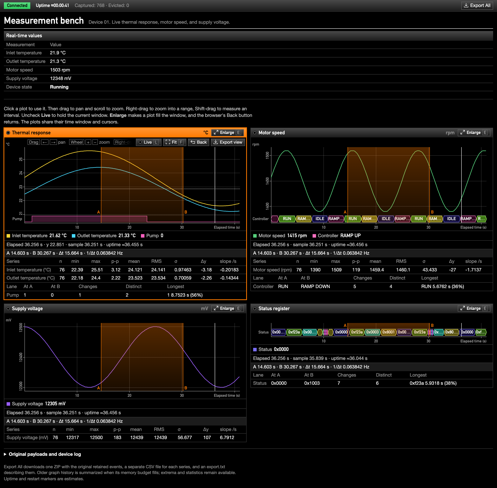

# TurboSSE

[](https://github.com/BuzzwordChief/TurboSSE/actions/workflows/build.yml)

Debug pages for embedded devices, driven by Server-Sent Events. Bind events to values and logs with HTML attributes, plot numeric series and discrete signals on synchronized scientific graphs with A/B measurements, and download everything as one ZIP. It is one JavaScript file and one stylesheet, about 22 KiB gzipped together, with no runtime dependencies, so a device can serve it straight from firmware.



## Features

- **Attribute bindings.** `data-sse-event`, JSON Pointer selection and your own transform functions update text, trusted HTML or append-only logs. The page needs no framework or build step.
- **Scientific plots.** Canvas time series with synchronized windows and cursors, pan, zoom, range zoom and live follow; any plot enlarges to fill the window. A/B measurements give count, extrema, peak-to-peak, mean, RMS, standard deviation, Δy and slope.
- **Discrete lanes.** States, registers and flags draw as timing-diagram lanes under a curve or on their own, with distinct, stable colors per value and measurements of dwell time and changes.
- **Bounded history.** Plots keep exact samples while their memory budget allows, then summarize older data without losing counts, extrema, means or deviations.
- **One-click exports.** Every export downloads one ZIP with the original events, one CSV per series and an `export.txt` describing the snapshot.
- **Connection awareness.** A sticky topbar shows connection state, estimated device uptime and capture counters. Plots mark estimated device restarts, stalled streams reconnect with a resume cursor, and the browser asks before you leave with data you have not exported.
- **Classless styling.** The stylesheet also styles plain HTML such as tables, details, headings and columns, so a device page needs no classes or CSS of its own.
- **Firmware friendly.** The build emits C headers containing the minified script, plain or gzip-compressed.

## Quick start

### Run the demo

```sh
python3.9 -m venv .venv39
.venv39/bin/python -m pip install -r requirements-build.txt
.venv39/bin/python tools/build.py
.venv39/bin/python examples/server.py
```

Open <http://127.0.0.1:8000>. The demo server uses only the Python standard library and serves the built files from `dist/`; build again after changing `src/`. The demo page, [examples/index.html](examples/index.html), has no classes and no stylesheet of its own. Besides its numeric plots, it shows a pump logic lane, a controller state lane and a status register graph made of a single lane.

Simulate faults and load:

```sh
.venv39/bin/python examples/server.py --disconnect-every 10   # drop the connection; device uptime continues
.venv39/bin/python examples/server.py --stall-after 5         # stop sending; the 30 s watchdog reconnects
.venv39/bin/python examples/server.py --restart-every 20      # restart the simulated device and its uptime
.venv39/bin/python examples/server.py --rate 100              # sample groups per second, 0.1 to 1000
```

`--host` and `--port` set the listener, localhost port 8000 by default. The server sends a fresh snapshot on each connection and does not replay missed history. The demo's 1 MiB graph budget makes history compaction easy to see at higher rates. Press Ctrl+C to stop it.

### Add it to a device page

Copy `dist/turbo-sse.min.js` and `dist/turbo-sse.css` onto the device, or take them from a [release or CI artifact](#continuous-integration-and-releases). No Node.js, bundler, CDN or Python is needed on the device.

```html
<head>
  <link rel="stylesheet" href="/turbo-sse.css">
  <script defer src="/debug-transforms.js"></script>
  <script defer src="/turbo-sse.min.js"></script>
</head>
<body data-sse-connect="/events"
      data-sse-events="diagnostic"
      data-sse-timeout="30000">
  <p>Temperature:
    <span data-sse-event="temperature"
          data-sse-transform="celsius_to_degree">—</span>
  </p>

  <p>RPM:
    <span data-sse-event="telemetry" data-sse-json="/rpm">—</span>
  </p>

  <pre data-sse-event="log"
       data-sse-swap="append"
       data-sse-limit="500"></pre>
</body>
```

Transform functions such as the one in `debug-transforms.js` belong to your application:

```javascript
window.celsius_to_degree = function (value) {
  const degrees = Number(value);
  return Number.isFinite(degrees) ? `${degrees.toFixed(1)} °C` : "—";
};
```

The device serves an event stream such as:

```text
retry: 2000

id: boot42:1
event: temperature
data: 23.6

id: boot42:2
event: telemetry
data: {"rpm":1450,"voltage":12.4}

id: boot42:3
event: log
data: Motor started
data:

event: heartbeat
data: alive

```

The temperature shows `23.6 °C`, the RPM shows `1450`, and the log appends `Motor started\n`. Each event ends with a blank line; the empty second `data:` line preserves the log entry's trailing newline.

Serve UTF-8 with `Content-Type: text/event-stream` and `Cache-Control: no-cache`, flush complete events, and disable any proxy buffering. Keep messages small; 16 KiB or less is recommended. The demo server's `encode_event()` handles strings, multiline data, Unicode and empty IDs; encode JSON payloads explicitly with `json.dumps()`.

## Plots

Add `data-sse-graph` to a numeric binding. The event and JSON selection attributes work unchanged:

```html
<div data-sse-event="temperature"
     data-sse-graph data-sse-label="Temperature" data-sse-unit="°C"></div>
```

A graph element without its own event binding overlays the series inside it. Graphs with the same `data-sse-sync` name share their time window, cursor and A/B markers:

```html
<div data-sse-graph data-sse-title="Thermal response" data-sse-sync="motor" data-sse-window="60">
  <span data-sse-event="telemetry" data-sse-json="/inlet"
        data-sse-label="Inlet" data-sse-unit="°C"></span>
  <span data-sse-event="telemetry" data-sse-json="/outlet"
        data-sse-label="Outlet" data-sse-unit="°C"></span>
</div>
<div data-sse-event="telemetry" data-sse-json="/rpm"
     data-sse-graph data-sse-sync="motor"
     data-sse-label="Motor speed" data-sse-unit="rpm"></div>
```

- Keep one unit per graph, and stack graphs for different quantities. The first graph in a sync group sets the group's Live window.
- Graphs fill their container. The plot area is 220 px tall; set `--turbo-sse-height` in CSS to change it. `data-sse-y-min` and `data-sse-y-max` fix the y range.
- Each graph generates a header with its title and the units of its series. The title is `data-sse-title`, else the graph's own `data-sse-label`, else the series labels.
- Graphs own the header, controls, canvas and legend they generate. They hide their source elements while they exist and show them again when destroyed.

### Controls

A plot is inactive until you click it or move keyboard focus into it. Hovering an inactive plot shows "Click to interact", and the wheel scrolls the page as usual. The first click only activates the plot, which then wears an orange frame and header; clicking elsewhere or tabbing away deactivates it.

| Action | Pointer | Keyboard |
| --- | --- | --- |
| Pan | Drag | <kbd>←</kbd> <kbd>→</kbd> |
| Zoom around the pointer | Wheel | <kbd>+</kbd> <kbd>−</kbd> |
| Zoom to a time range | Right-drag; with Shift, also zooms y | |
| Measure an interval | Shift-drag; over a lane, markers snap to its changes | <kbd>A</kbd> and <kbd>B</kbd> at the cursor, or the view center |
| Clear markers, cancel a drag; then leave the enlarged view | | <kbd>Esc</kbd> |
| Follow new data | **Live** switch | <kbd>L</kbd> |
| Show all history with automatic y | **Fit** | <kbd>F</kbd> |
| Return to the previous view | **Back** | |
| Hide or isolate a series | Click or Shift-click its legend entry | <kbd>Enter</kbd> or <kbd>Space</kbd> on the entry |
| Download the plot's data | **Export view** | |
| Enlarge the plot to fill the window, and return | **Enlarge**, then **Reduce**, in the plot header | <kbd>E</kbd> |

On touch screens an inactive plot lets the page scroll, the first tap activates it, drag pans, and two taps set A and B. Buttons are taller there.

- **The control band.** While a plot is active, a one-row band above the data shows Live, Fit, Back and Export view on the right, and a key legend on the left. A legend that does not fit shows as much as it can and fades out; hovering it shows the full legend over the top of the plot. The band is reserved, so it never covers data. Touch screens show no key legend.
- **Live and Fit.** The Live switch and the lamp in each plot's header are lit green while the plot follows new data, so a held plot stands out even when its controls are hidden. While Live is checked, the wheel only changes the followed window, so zooming keeps tracking new data. Panning or range zoom unchecks Live, and checking it again keeps the current span. Fit is a one-time action that leaves Live as it is; while Live is checked, the followed window then covers all history as data arrives.
- **Enlarge.** The Enlarge button in a plot's header is always visible. It makes the plot fill the window below the topbar, with the spare height going to the plot area, and then reads Reduce. Enlarging adds a browser history entry, so the browser's Back button returns to the page instead of leaving it, and Forward enlarges the plot again; the button, <kbd>E</kbd> and <kbd>Esc</kbd> go back the same way. The page behind keeps its scroll position, the other plots stop drawing until you return, and a plot of lanes only keeps the height of its lanes.
- **Focus.** Shortcuts work while a plot is active, wherever focus is inside it; combinations with Ctrl, Cmd or Alt are left to the browser. Clicking a toolbar control keeps the plot active and returns focus to it, while a control activated from the keyboard keeps focus.
- **Reading values.** Hovering shows a crosshair; the readout row gives the elapsed time, the y value under the pointer, the nearest sample and its estimated uptime. Y tick labels read bottom to top, so the y axis needs only one line of text; long labels get fewer ticks.
- **Legend.** Legend entries brighten under the pointer. A hidden series keeps an outlined swatch and keeps recording. Legend, readout and measurement text can be selected and copied; selecting legend text does not toggle the series.

### Measurements

Measuring or placing a marker unchecks Live so the markers stay in view. The markers are labelled A and B on the outer side of the interval, as an orange band; a range zoom in progress shows as a striped band with dashed edges.

Below the readout, an A/B line gives both marker times, Δt and 1/Δt. A table gives each series' count, minimum, maximum, peak-to-peak, mean, RMS, population standard deviation, Δy and slope. The line and one row per series are always present, so measuring never moves the page; the table scrolls sideways on plots too narrow for it.

### Discrete lanes

Add `data-sse-discrete` to a series to draw it as a lane: a timing-diagram row for values such as states, register contents or flags. Lanes can sit under a numeric curve in the same graph, or make up a graph of their own:

```html
<div data-sse-graph data-sse-title="Motor speed" data-sse-sync="bench">
  <span data-sse-event="telemetry" data-sse-json="/rpm" data-sse-label="Motor speed" data-sse-unit="rpm"></span>
  <span data-sse-event="telemetry" data-sse-json="/state" data-sse-discrete data-sse-label="Controller"></span>
  <span data-sse-event="telemetry" data-sse-json="/pump" data-sse-discrete="logic" data-sse-label="Pump"></span>
</div>
<div data-sse-graph data-sse-title="Status register" data-sse-event="telemetry" data-sse-json="/status"
     data-sse-transform="hex16" data-sse-discrete data-sse-label="Status"></div>
```

- **Modes.** `data-sse-discrete` alone, or `data-sse-discrete="bus"`, draws each value as a labelled segment with slanted ends at every change. `data-sse-discrete="logic"` draws a two-level signal: `1`, `true`, `on`, `high` and non-zero numbers are high; `0`, `false`, `off` and `low` are low, ignoring case.
- **Values.** A lane's value is its text after JSON selection and the transform, so a transform may return a string such as `0xf23a`. A value holds until the next change; repeated values only confirm it, and only changes are stored. Missing, empty and unrecognized values leave a gap, as does a disconnect, so send the current value again after connecting. Unrecognized logic values count as Graph errors.
- **Drawing.** Lanes are one text line tall and stack below the numeric area in markup order, sharing its time axis. A graph with only lanes has no y axis, and its height follows its lanes. Lane names sit in the left gutter; synced graphs share one gutter width, so stacked time axes line up. Changes too close together to draw show as a gray block with their count, and zooming in resolves them.
- **Colors.** A hash of each value's text picks two of 24 colors: eight hue families, none of them red or orange, each in three dark tints that keep white text readable and outlined in a bright tone of the hue. The second color always has a different hue. A value takes its first color unless another value in the same lane already has that hue; then it takes its second. So a value usually keeps its color across lanes, graphs and sessions, while values in the same lane mostly get different hues. The legend shows the value at the cursor with its color. Logic lanes use the series color.
- **Measuring.** Markers placed within 5 px of a change over a lane snap to it. A second table lists each lane's value at A and at B, the changes between them, the distinct values, and the value held longest with its share of the interval. Counts that include summarized history are marked `≥`.

### Graph values

Graphs accept numeric strings and selected JSON numbers. Null, missing or invalid data leaves a visible gap, and invalid numbers increment the Graph errors counter. A graph transform must be synchronous and pure and return a number, `null` or `undefined`; `undefined` skips the update. Use a numeric conversion for graphs: a display transform that returns `"23.6 °C"` is not a graph value.

Bindings with the same event, selector, transform and unit share one history and evaluate their transform once per event, even across several graphs. Text bindings keep their own transform calls.

## Attributes

| Attribute | Behavior | Default |
| --- | --- | --- |
| `data-sse-connect` | SSE URL on the single connection root | Required |
| `data-sse-events` | Additional event names to capture, separated by whitespace | None |
| `data-sse-timeout` | Silence timeout in milliseconds | `0`, disabled |
| `data-sse-buffer-events` | Maximum retained raw events | `10000` |
| `data-sse-buffer-bytes` | Raw capture string-storage budget | `2097152` |
| `data-sse-omit-raw` | Event names to leave out of raw capture only | Empty: omit nothing |
| `data-sse-uptime-event` | Event carrying the device uptime in seconds | `uptime` |
| `data-sse-graph-bytes` | Graph history budget; minimum 8192 | `33554432` (32 MiB) |
| `data-sse-graph` | Plot a binding, or overlay the series inside the element | Absent |
| `data-sse-discrete` | Draw the series as a lane: `bus`, or `logic` for a two-level signal | Absent: numeric curve |
| `data-sse-sync` | Group sharing time window, cursor and markers | Independent |
| `data-sse-title` | Graph header title | The graph's label, else its series labels |
| `data-sse-label`, `data-sse-unit` | Series name and unit | Event name; no unit |
| `data-sse-window` | Initial and Live visible seconds; positive finite number | `60` |
| `data-sse-y-min`, `data-sse-y-max` | Fixed y bounds; min below max | Automatic |
| `data-sse-event` | Event name for a binding; `message` for unnamed events | Required |
| `data-sse-json` | JSON Pointer selecting a value; `""` selects the whole document | Absent: raw string |
| `data-sse-transform` | Name of your global transform function | None |
| `data-sse-swap` | `replace` contents or `append` entries | `replace` |
| `data-sse-format` | `text` or trusted `html` | `text` |
| `data-sse-limit` | Maximum retained entries in an append target | `500` |

- One connection root per page. Bindings must be descendants of the root and must not contain other bindings.
- Numeric limits must be positive safe integers; the timeout also accepts zero. Root options are read at initialization; changing them requires `destroy()` and `init()`.
- Events named in bindings are subscribed automatically. List every other event in `data-sse-events` if it should appear in the raw export; `EventSource` has no wildcard subscription, so unknown names cannot be observed. `message`, `heartbeat` and the uptime event are always subscribed. Reserve `open` and `error` for the connection lifecycle.

## Values, logs and transforms

Text bindings render strings literally, including leading zeros, JSON-looking text and HTML characters. Replacement keeps the bound element. Append adds one entry per event without separators and never reparses earlier entries. Append targets are owned by the library, start empty, and reset when a refresh changes their configuration.

`data-sse-format="html"` inserts trusted device-generated markup without sanitizing it. A fragment of several nodes counts as one append entry, and inserted HTML is not scanned for new bindings.

JSON is parsed only for bindings with `data-sse-json`, at most once per message. JSON Pointer reaches nested objects and arrays, such as `/sensors/0/value`; write `~1` for `/` and `~0` for `~` in keys. A missing path leaves the binding unchanged. Malformed JSON skips JSON bindings and counts a JSON error, while raw bindings and capture continue.

Values flow from the raw string or selected JSON value, through an optional transform and text conversion, to the DOM. With `{"temperature":23.6}` and `data-sse-json="/temperature"`, the transform receives the number `23.6`; without `data-sse-json` it receives the original string. Transforms work with appending too.

- Define transforms on `window` before the library initializes. Module scripts can assign to `window` and then call `TurboSSE.refresh()`.
- Names are resolved and cached at initialization and refresh. Attributes take simple names only, with no expressions, calls or dotted paths.
- Transforms run synchronously, once per matching binding per message, before rendering is batched. Keep them fast, and treat shared JSON input as read-only.
- Strings render as returned, numbers and booleans become text, objects and arrays become compact JSON, and `null` becomes an empty string. `undefined` skips the update.
- A missing function disables its bindings until a successful refresh. Exceptions, asynchronous results and unsupported return types skip only that update and show in the topbar counters.
- Output is literal text unless HTML mode is enabled. The raw export keeps the original payload, even when a transform fails.

## Connection, uptime and restarts

The status badge in the topbar takes the color of the connection state: yellow while Connecting and Reconnecting, green when Connected, red when Stalled and Disconnected. A fault also turns the rule under the topbar red. Screen readers announce state changes, and counters update at most once a second. Export progress and errors appear next to **Export All**.

Transient failures use the browser's `EventSource` reconnect and the server's `retry:` interval. A terminal closure, including HTTP 204, shows Disconnected and a **Retry** button; the browser does not reveal the HTTP status.

With `data-sse-timeout` set, send a named heartbeat event at least three times per timeout, for example every 10 seconds for a 30-second timeout. Any captured message counts as activity; SSE comments do not. A silent open stream is closed and reopened after two seconds. The watchdog pauses during the browser's own reconnect attempts.

Native reconnects send `Last-Event-ID`. Watchdog and manual reconnects pass the last ID as a URL-encoded `lastEventId` query parameter. Firmware should prefer the header, then the query parameter. Use IDs with a boot or session prefix, and replay from a small device-side buffer if you have one, or else send a fresh snapshot. TurboSSE does not deduplicate events or recover history the device cannot replay.

### Uptime

```html
<body data-sse-connect="/events" data-sse-uptime-event="uptime">
```

```text
event: uptime
data: 1234.567

```

The payload is a finite, non-negative number of seconds; no JSON, boot ID or per-sample timestamp is needed. One report starts the estimate and periodic reports correct it; send one on each connection if reconnect synchronization matters. Invalid reports keep the previous estimate and count a Clock error.

The topbar shows `Uptime ≈HH:MM:SS`, advancing once a second from the last report. It shows unknown time before the first report and after a disconnect until a new report arrives. Samples keep the uptime estimated when they arrived.

### Restarts

After a reconnect, the first valid uptime report is compared with the last reported one. A lower value adds an estimated restart marker and starts a new local segment, which is bookkeeping rather than a device identifier; earlier history stays available. Periodic reports never add markers. The marker's time is the report's arrival minus its uptime, so network buffering, clock drift and browser suspension affect it, and a restart is missed if the new uptime already exceeds the last one seen.

## Exports

Captured data lives only in the page. While events have arrived since the last **Export All** or `TurboSSE.exportCSV()`, closing, reloading or leaving the page makes the browser ask for confirmation. Browsers word that question themselves, and show it only after you have clicked or typed in the page. Export view saves one plot's interval and does not count.

Every export downloads one ZIP named `sse-<timestamp>.zip`, even when it holds a single CSV:

- **Export All** in the topbar includes `raw-events.csv` and one CSV per unique series. Pages without graphs get just the raw file.
- **Export view** includes one plot's series for its visible or A/B interval.

Every ZIP starts with `export.txt`, which records when the snapshot was taken, whether it covers all retained data or a plot interval, and each file's coverage and size. Several plots of the same source produce one series file. The ZIP is stored uncompressed, so it is assembled from the prepared files without copying them; compress it afterwards if size matters.

Preparing an export freezes a bounded snapshot, yields between batches, and keeps acquisition running. One export is prepared at a time, within a temporary budget of 8 to 256 MiB derived from the capture and history budgets. An export that would exceed it fails with a message before anything downloads; use Export view for a smaller range. Prepared data is released 60 seconds after the download starts, when another export starts, or when the runtime is destroyed.

### Raw events

`raw-events.csv` and `TurboSSE.exportCSV()` use the columns `received_at,elapsed_ms,event,last_event_id,data`. `received_at` is browser wall-clock time, `elapsed_ms` is monotonic time since initialization, and `last_event_id` is the browser's resume cursor, which may be inherited from an earlier event. `data` is the original payload with only CSV escaping; SSE comments and framing are not captured.

Raw events are captured by default, even when graphed. To save capture space, omit whole events by name:

```html
<body data-sse-connect="/events"
      data-sse-omit-raw="temperature telemetry">
```

Omission drops the entire original payload, including unplotted JSON fields, and does not affect subscriptions, graphs, text and log bindings, uptime, liveness or resume cursors. Omissions have their own counter.

### Series files

Series files contain the numeric values actually plotted, after numeric transforms and before display rounding. They hold the retained samples and summaries, never the reduced set of drawing points. Each file is self-contained:

| Columns | Meaning |
| --- | --- |
| `series,event,json_pointer,transform,unit` | Series and source metadata. An empty selector means a raw source or whole-document JSON. |
| `kind` | `sample`, `summary`, `gap` or estimated `restart` |
| `elapsed_start_s,elapsed_end_s` | Point or covered interval in browser elapsed seconds |
| `uptime_start_s,uptime_end_s,segment` | Estimated device time and local segment; empty when unknown |
| `value,count` | Exact sample value and count; empty `value` for summaries |
| `min,max,mean,stddev,first,last,min_elapsed_s,max_elapsed_s` | Summary statistics and the times of the extrema; `stddev` is the population deviation. Empty for samples. |
| `gaps` | Number of gaps or invalid samples represented |
| `detected_elapsed_s` | When a restart was inferred, separate from its estimated position |

Lane files use their own columns, with one row per value held rather than per update:

| Columns | Meaning |
| --- | --- |
| `series,event,json_pointer,transform` | Lane and source metadata |
| `kind` | `value`, `gap`, `summary` or estimated `restart` |
| `elapsed_start_s,elapsed_end_s` | When the value was set, and when the next change or the end of the export came |
| `uptime_start_s,uptime_end_s,segment` | Estimated device time and local segment; empty when unknown |
| `value` | The value held; logic lanes use `1` and `0` |
| `changes,first,last` | For summaries: the number of changes and the first and last value |
| `detected_elapsed_s` | When a restart was inferred |

An Export view of a lane starts with the value already held at the start of the interval, so that row can begin earlier.

A summary describes several samples over an interval, and its mean is never exported as a pretend sample. An interval that intersects a summary includes the whole summary and reports the actual coverage. Gap and restart rows carry no value. Original payloads, unselected JSON fields and compacted samples cannot be rebuilt from series files; keep raw capture or record the stream externally when you need them.

## Memory bounds

- **Raw capture** is a ring buffer limited by event count and string storage. The byte budget charges two bytes per UTF-16 code unit of payloads, names and IDs. The oldest events are evicted whole; an event larger than the whole budget is dropped, counted as Oversized, and still rendered.
- **Append targets** each have a 256 KiB budget for transformed output, shared by pending and displayed entries. Old entries are discarded and counted as Append drops. Replacement targets keep only the newest pending value per animation frame.
- **Graph history** uses indexed Float64 chunks and statistical summaries, exact while the shared budget allows; a busy series can use idle series' space. Under pressure, the oldest raw blocks become summaries that keep count, extrema and their times, first and last values, mean, deviation and gaps, and older summaries merge progressively. Retention does not depend on a fixed age or the visible window. Different restart segments are never merged into one summary. If even summaries run out of space, the oldest coverage expires and is counted.
- **Lanes** store one entry per change in the same history store and budget, so a lane that rarely changes costs little. Under pressure, the oldest changes become summaries that keep the change count and the first and last value. Each lane also keeps up to 1,024 distinct values of up to 64 characters, outside the graph budget; longer values are cut, and further new values count as Graph errors and leave a gap.
- `data-sse-graph-bytes` covers typed storage plus node and bookkeeping allowances; each distinct source needs at least 4 KiB, and restart markers have a small separate reserve. Canvas and other browser memory come on top. These are limits on managed storage, not exact heap measurements.

## Styling

`turbo-sse.css` follows a camera's menu and on-screen display: true black, white readouts, gray labels, 1 px rules and square corners, with tabular figures for numbers. Bars and buttons share one gloss, a light sheen over each one's own color. Titles and readouts use a bold DIN face that ships with the system, DIN Alternate on Apple devices and Bahnschrift on Windows; labels and prose use Helvetica or Arial. The page is dark only, and nothing is downloaded.

Each color has one meaning:

| Color | Meaning |
| --- | --- |
| Orange | Your selection: the active plot's frame and header bar, keyboard focus, hovered and pressed controls, the A/B interval and selected text |
| Green | Live: connected, or a plot following new data |
| Yellow | In between: connecting or reconnecting |
| Red | A fault: stalled or disconnected, and estimated restarts |

The connection state fills the status badge in the topbar. Round lamps, lit green, show which plots follow new data: one in each plot header and one in the Live switch. Export, Retry, Fit, Back and Enlarge carry 11 px icons that are embedded in the stylesheet as masks, so they take the text color and need no image files.

It is also a small classless stylesheet for the page around the plots:

- `body` and `main` set the font, colors and a centered page up to 1920 px wide. Set `--turbo-sse-page-width` to change the width; the topbar keeps its full-width background and lines its content up with the page.
- Each `<section>` directly inside `<main>` becomes a column. Neighbouring columns share a row when each can be at least 480 px wide, grow to fill it, and stack otherwise. Everything else in `<main>` takes a full-width row.
- A `<header>` directly inside `<main>` sets the `<h1>` title and a gray `<p>` tagline on one ruled line. `<h2>` is a smaller title.
- `<h3>` and table `<caption>` are dark gray bands like the plot headers, so a captioned table reads as a panel.
- Tables collapse their borders and rule their rows. Header cells are gray labels and data cells are white; row headers in `tbody` size to their content, and cells use tabular figures. `<hr>` is a gray rule.
- `<details>` is set off by a rule with a bold `<summary>`, and `<section>` blocks inside it get a border. `<pre>` wraps long lines and scrolls beyond 240 px.
- A `<p>` or `<footer>` directly inside `<main>` keeps its lines to about 100 characters on wide pages.
- `<footer>`, links, `<kbd>`, buttons, disabled buttons, focus rings and selected text get matching styles, and `[hidden]` always hides.

These are plain element selectors, so your own rules for the same elements override them. The canvas takes its axis, tick and grid color from the computed `color` of `.turbo-sse-area`. Series colors come from a fixed six-color palette and are exposed to the legend as `--series-color`. The palette is made for thin lines on black: every pair stays distinct with red-green color blindness, and it leaves red and orange to restart markers and the selection.

## JavaScript API

```javascript
TurboSSE.init();       // Runs automatically on page load; repeated calls are harmless.
TurboSSE.refresh();    // Rescan bindings and re-resolve transforms after markup changes.
TurboSSE.exportCSV();  // Download the raw events as CSV; also returns the CSV text.
TurboSSE.stats();      // Counters, connection state, retained bytes and lastEventId.
TurboSSE.destroy();    // Close the stream, cancel work, release data, remove generated UI and the leave warning.
```

`init(rootElement)` selects the root explicitly. `refresh()` preserves unchanged append bindings, shared graph histories, inspection state and existing subscriptions. Label changes keep graph data; changing a graph source or its transform resets that source, and removing one plot keeps a source still used by another.

`stats()` returns a copy with `received`, `retained`, `bytes`, `evicted`, `oversized`, `parseErrors`, `transformErrors`, `configErrors`, `appendDrops`, `state`, `lastEventId`, `omitted`, `clockErrors`, `restarts`, `graphErrors`, `markerEvictions`, the estimated `uptime` (or `null`), `lastUptime`, `segment` and `graphs`. `graphs` holds the accounted `bytes`, the plot count, and a series list with `id,label,event,raw,compacted,evicted,bytes,samples,gaps,from,to`, where coverage is in browser elapsed seconds. `samples` counts retained measurements including those inside summaries, `raw` counts exact records including gaps, `compacted` counts records turned into summaries, and `evicted` counts expired records. Counters are cumulative since initialization.

After `destroy()`, `stats()` returns `null` and a later `init()` starts a fresh session. Values already rendered into the page stay.

## Serving from firmware

The build writes C headers for the script and stylesheet, each named after the asset it embeds plus `.h`. Include one in the source file that serves it, so firmware keeps a single copy.

| Header | Symbols | Serve with |
| --- | --- | --- |
| `dist/turbo-sse.min.js.h` | `turbo_sse_js`, `turbo_sse_js_len` | `Content-Type: text/javascript; charset=utf-8` |
| `dist/turbo-sse.min.js.gz.h` | `turbo_sse_js_gz`, `turbo_sse_js_gz_len` | The same type plus `Content-Encoding: gzip` |
| `dist/turbo-sse.css.h` | `turbo_sse_css`, `turbo_sse_css_len` | `Content-Type: text/css; charset=utf-8` |
| `dist/turbo-sse.css.gz.h` | `turbo_sse_css_gz`, `turbo_sse_css_gz_len` | The same type plus `Content-Encoding: gzip` |

Each header defines a `const unsigned char[]` with the exact bytes of its asset, and a `const size_t` length, both with internal linkage. Send exactly the given length; the arrays have no trailing NUL, and the gzip data contains NUL bytes, so never use `strlen`. With a gzip header the browser decompresses; the device compresses nothing at runtime. When sending `Content-Length`, use the compressed length. The headers have distinct symbols and include guards, so they can be used together. Adapt the storage placement to your platform if needed.

When serving the `dist/` files from a file system instead, serve any `.gz` asset with its original content type plus `Content-Encoding: gzip`, rather than linking to the `.gz` file directly.

## Development

### Build and test

The tooling uses Python 3.9. [rjsmin](https://pypi.org/project/rjsmin/) is the only build dependency; Playwright is needed for the browser tests.

```sh
python3.9 -m venv .venv39
.venv39/bin/python -m pip install -r requirements-dev.txt
PLAYWRIGHT_BROWSERS_PATH="$PWD/.playwright" .venv39/bin/python -m playwright install chromium firefox webkit
.venv39/bin/python tools/build.py
.venv39/bin/python -m unittest discover -s tests -v
.venv39/bin/python tools/build.py --check
```

The build writes minified assets, deterministic `.gz` variants and the C headers to `dist/`, which is not committed. It reports the combined gzip size against a soft 8 KiB target and fails above the 22 KiB regression ceiling. `--check` fails if any generated file is stale.

The tests run real localhost SSE endpoints in Chromium, Firefox and WebKit, covering rendering, transforms, capture limits, downloads, reconnects, watchdogs, plot interaction, exports and the demo page. Header tests compile C99 and C++11 programs against all headers, and need `cc` and `c++`. While developing:

```sh
.venv39/bin/python -m unittest tests.test_browser.ChromiumTests -v   # one engine
TURBO_SSE_BROWSERS=chromium,firefox .venv39/bin/python -m unittest discover -s tests
TURBO_SSE_ASSET=src/turbo-sse.js .venv39/bin/python -m unittest tests.test_graphs   # readable source
```

### Benchmarks

```sh
# Raw, JSON and mixed bindings under load:
.venv39/bin/python tools/benchmark.py --seconds 600 --rate 1000 --bindings 100 \
  --mode mixed --transform --output benchmarks/local.json
# Eight simulated hours of graph history, processed at full speed:
.venv39/bin/python tools/benchmark_graphs.py --mode history --seconds 28800 \
  --rate 100 --channels 8 --output benchmarks/local-history.json
# Real-time SSE streaming to four plots, with periodic exports:
.venv39/bin/python tools/benchmark_graphs.py --mode soak --seconds 1800 \
  --rate 100 --channels 8 --budget 8388608 --export-every 300 \
  --output benchmarks/local-soak.json
```

`tools/benchmark.py` accepts `--mode raw`, `mixed` or `json`; omit `--transform` to measure untransformed values. It briefly suspends rendering to exercise pending queues. History mode checks the production history store against independent reference statistics without waiting for the simulated time. Soak mode streams real SSE to canvas plots and verifies every export ZIP. Reports record the tested asset hash, browser, heap samples and callback timings; callback times exclude browser paint.

### Continuous integration and releases

The **Build minified library** workflow runs on pushes, pull requests, published releases and manual dispatch. It builds with Python 3.9, checks the size ceiling and generated files, runs the server and C header tests, and uploads a `turbo-sse-dist` artifact, kept for 30 days, with:

- `turbo-sse.min.js` and `turbo-sse.css`
- their `.gz` variants
- `turbo-sse.min.js.h`, `turbo-sse.min.js.gz.h`, `turbo-sse.css.h` and `turbo-sse.css.gz.h`

Publishing a GitHub Release attaches the same eight files to it; pushing a tag alone only produces the artifact. The build job has read-only permissions, and only the release upload job can write. To attach files to an existing release, run the workflow manually from the default branch with **release_tag** set to its tag. It checks out and rebuilds that tag, which must already contain the build tooling, and replaces assets with the same names without moving the tag. Leave **release_tag** empty for a normal build.

## Validation

[VALIDATION.md](VALIDATION.md) records the test environment, numerical checks against reference statistics, live-run results, distribution sizes and the SHA-256 hashes of the tested build. The script and stylesheet total 22,172 bytes gzipped.
